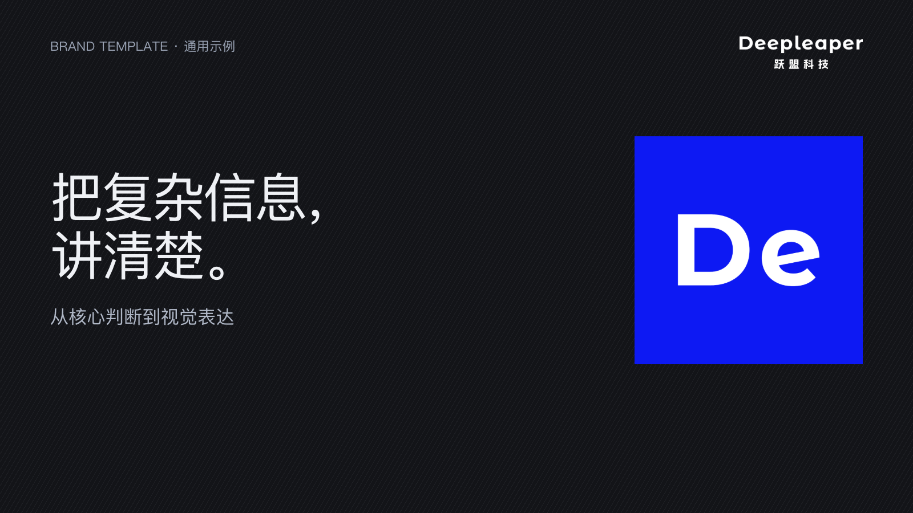
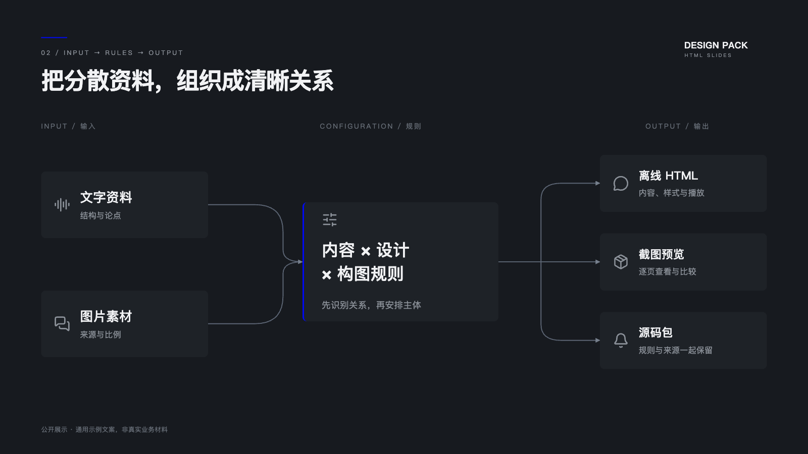
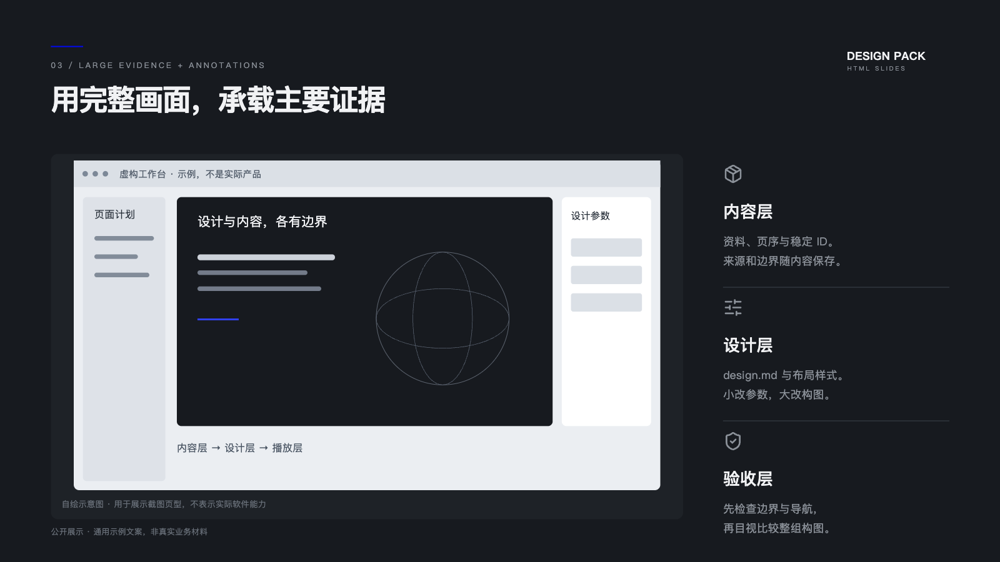
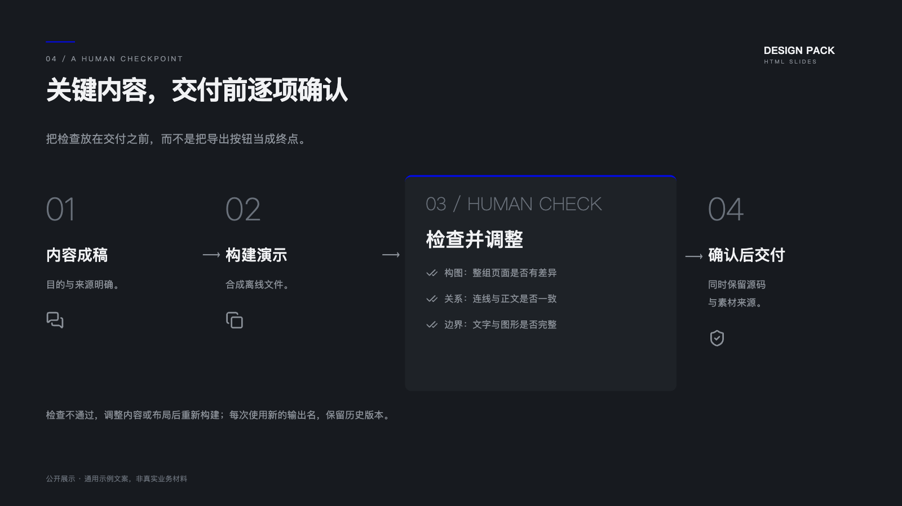

# webppt-maker

把大纲、演讲稿和业务资料制作成可离线播放的 HTML 幻灯片，支持文字编辑、逐页讲稿和另存新版本。

**技能入口：[SKILL.md](SKILL.md)**

## 效果预览

以下为本技能示例页面的实际浏览器截图，展示品牌封面、关系图、证据主导页与核对流程。文案已替换为通用示例；不含真实客户信息、业务数据或讲稿。Deepleaper Logo 经授权保留，界面插图为虚构示意。**这是 HTML 渲染效果，不是 PowerPoint 无损还原证明。** 点击图片查看大图。

| 品牌封面 · Deepleaper Dark | 关系图 · 输入、规则与输出 |
|---|---|
| [](docs/screenshots/brand-cover.png) | [](docs/screenshots/relationship.png) |
| **证据主导页 · 完整画面与旁注** | **核对流程 · 突出人工确认关卡** |
| [](docs/screenshots/evidence.png) | [](docs/screenshots/checkpoint.png) |

## 为什么选 webppt-maker

适合需要**反复确认内容、精修画面，再交付演示文件**的场景。与下列常见制作路径相比，本项目更强调这些环节；这是工作方式的差异，不是对所有同类 Skill 的实测排名。

| 对比路径 | 本项目的侧重点 | 实际价值 |
|---|---|---|
| 从资料直接进入排版 | 叙事大纲 → 制作大纲 → 设计制作，保护已确认的标题、副标题与页序 | 先确定讲什么，减少后期推倒重排 |
| 用固定页型逐页填空 | 先识别比较、流程、层级等内容关系，再决定构图；不默认每页三张卡片 | 让图形表达关系，而不只是装饰段落 |
| 品牌模板只是换配色、套固定版式 | 模板保存规范与素材，区分固定项、可调默认值和自由构图 | 同一品牌保持一致，不把所有内容塞进一种布局 |
| 每次小改都重新生成整稿 | HTML 可在浏览器改字、写讲稿、打开演讲者窗口，并另存新版本 | 文案微调可直接完成；长文修改后仍需检查排版 |
| 制作时同时生成 HTML 和 PPTX | 先验收 HTML，明确要求后才从最终保存版本导出 PPTX | 避免每轮都转换两份，不用另一套生成器重新设计 |
| 把整页截图放进 PPT | 文字与基础几何尽量原生，复杂效果局部图片化，并附转换报告 | 保留后续编辑空间，也明确哪些内容不能逐项编辑 |

**不是所有场景都更合适：**若只要一次性原生 PPTX、复杂可编辑数据图表或已有 PPTX 的直接编辑，应选专门的 PowerPoint 工具。转换边界见[输出格式](#输出格式)。

## 安装

```bash
npx skills add chjm-ai/webppt-maker
```

按提示选择目标工具与安装范围，安装后新开会话。安装需保留完整技能目录，不能只复制 `SKILL.md`。

## 使用

直接告诉 AI 你要做什么，例如：

- “先帮我讨论一份产品介绍的大纲，暂时不要设计。”
- “按已确认的大纲制作 10 页 HTML 演示，使用 D Dark 模板。”
- “只修改第 3 页，保留其他页的内容和风格。”
- “HTML 效果已确认，把这份保存后的文件导出为可编辑 PPT。”

支持三个阶段：**叙事大纲 → 制作大纲 → 设计制作**。默认逐阶段确认；已有确认稿可直接进入对应阶段，也可明确要求全流程直接完成。

生成的 HTML 用浏览器打开即可播放，无需启动服务。

| 操作 | 快捷键 |
|---|---|
| 翻页 | 方向键；手机横向滑动 |
| 总览／全屏 | O／F |
| 编辑文字／退出编辑 | E／Esc |
| 当前页讲稿 | N |
| 演讲者窗口 | S |
| 保存新 HTML | Ctrl／Cmd+S |

保存会下载新文件，不覆盖原稿或回写源码。**分享的 HTML 包含讲稿**，发送前检查内部信息；修改长文后需重新检查排版。

## 模板

模板保存设计规范与素材，不固定每页构图。

- `designs/d-dark/`：公共无品牌深色模板 D Dark。
- `designs/deepleaper-dark/`：内置 Deepleaper 品牌规范与 Logo，含三页虚构示例 `example/deepleaper/`。
- `designs/gray-orbit/`：随附五页示例使用的设计。
- `data/templates/<name>/`：本地私有模板，可保存 Logo、字体和图片；已被 Git 忽略，需自行备份。

可指定模板、不使用模板，或从满意的成品中提炼新模板。单次作品修改不会自动回写模板。详见 [模板指南](references/templates.md)。

## 输出格式

| 格式 | 支持情况 |
|---|---|
| 离线 HTML | 主要交付，支持播放、改字、讲稿与保存 |
| PDF | 可通过浏览器打印，需检查分页与字体 |
| PowerPoint `.pptx` | HTML 确认后按需导出；原生文字／基础形状＋局部图片，附转换报告 |

**先只做 HTML，明确要求导出时才生成 PPTX。** 支持本技能生成及保存后的自包含 HTML，不是任意网页无损转换。复杂纹理、Logo、SVG 等可局部图片化；字体不嵌入，动画、交互与讲稿不导出。交付前需在 PowerPoint 中逐页复核。

导出环境单独选装，普通 HTML 构建不增加依赖：

```bash
uv sync --extra pptx
uv run playwright install chromium
uv run python scripts/export_pptx.py --html output/confirmed.html --out output/confirmed-editable.pptx
```

输出 `.pptx` 与同名 `.report.json`，均不覆盖已有文件。报告说明原生对象、局部图片及警告；详见 [导出边界与验收](references/pptx-export.md)。

## 本地构建与测试

构建需要 Python 3.11+，仅依赖标准库。在技能根目录执行：

```bash
python3 scripts/build.py --out output/demo.html
python3 scripts/build.py --help
python3 -m unittest discover -s tests -v
```

可选浏览器验收：

```bash
uv sync --extra dev
uv run playwright install chromium
uv run python scripts/check_browser.py
uv run python scripts/check_editing.py
```

自有作品放在独立内容目录，不覆盖 `example/`；构建器拒绝覆盖已有输出。浏览器检查不代替内容、视觉和实体投影验收。

## 项目结构

- [SKILL.md](SKILL.md)：制作流程与约束。
- `references/`：大纲、构图、模板、分割线和图标指南。
- `designs/`：公共设计规范与样式。
- `runtime/`：播放器与打印样式。
- `example/`：五页虚构示例与素材。
- `assets/icons/`：精选 Lucide／Phosphor SVG，附来源及许可。
- `docs/screenshots/`：README 效果预览，仅含通用示例文案。
- `scripts/`、`tests/`、`evals/`：构建工具、自动测试与行为评测用例。

示例不包含真实客户资料；使用第三方素材时需保留对应许可。
